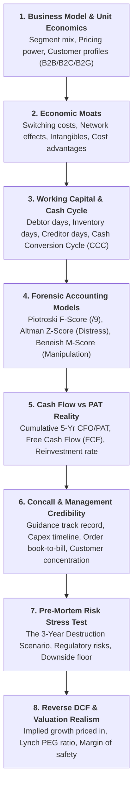

# Deep Stock Intelligence & 360-Degree Forensics Skill

This skill teaches the agent how to perform **deep, multi-dimensional, institutional-grade equity analysis** that goes far beyond headlines and simple P/E ratios to understand the complete inner workings of any business.

---

## 🎯 When to Use This Skill
Activate this skill whenever:
- Analyzing any direct stock holding or new screener discovery candidate.
- Conducting fundamental research, balance sheet audits, or cash flow forensics.
- The user asks for in-depth analysis ("understand in and out", "deep dive", "forensics", "concall breakdown", "reverse DCF", "red flag check").
- Evaluating earnings quality, bankruptcy risk, manipulation flags, or promoter governance.

---

## 🏛️ The 8 Pillars of 360-Degree Stock Intelligence

Every stock evaluated must undergo examination across all 8 forensic pillars:



---

### Pillar 1: Business Model & Unit Economics Dissection
- **Revenue Engine**: How does the company make money? What are the high-margin vs low-margin segments?
- **Customer Breakdown**: B2B (Enterprise), B2C (Retail), or B2G (Government)?
  * *Critical Rule*: High B2G concentration (like SRM Contractors in J&K) leads to long working capital cycles and delayed billings.
- **Value Chain Positioning**: Is the company a price-taking commodity supplier or a pricing-setting proprietary IP owner?

---

### Pillar 2: Economic Moats & Competitive Defensibility
- **High Switching Costs**: Does replacing this product cause operational downtime or mission risk? (e.g. ERP software, DRDO avionics).
- **Intangibles & Regulatory Licensing**: Sovereign visa processing concessions (BLS), defense certifications, patents.
- **Scale & Cost Advantage**: Lowest cost producer per unit.
- **Network Effects**: Two-sided platform dynamics.

---

### Pillar 3: Working Capital & Cash Conversion Cycle (CCC)
$$\text{Cash Conversion Cycle (CCC)} = \text{Debtor Days} + \text{Inventory Days} - \text{Creditor Days}$$

| Metric | Elite Benchmark | Warning Sign | Red Flag Trap |
|---|---|---|---|
| **Debtor Days (Receivables)** | < 45 Days | 60 - 90 Days | > 120 Days (SRM = 115d) |
| **Inventory Days** | < 30 Days | 45 - 75 Days | > 90 Days (Stale inventory) |
| **Cash Conversion Cycle** | < 30 Days (or negative) | 45 - 90 Days | > 120 Days (Severe liquidity strain) |

---

### Pillar 4: Institutional Forensic Accounting Models

#### 1. Piotroski F-Score (0 to 9)
Evaluates Profitability, Leverage/Liquidity, and Operating Efficiency:
- **Score 8-9**: Exceptionally strong compounder.
- **Score 6-7**: Solid fundamental health.
- **Score 0-4**: Fundamental deterioration — avoid or sell.

#### 2. Altman Z-Score (Distress & Bankruptcy Test)
$$Z = 1.2 X_1 + 1.4 X_2 + 3.3 X_3 + 0.6 X_4 + 0.999 X_5$$
- **$Z > 2.99$**: **Safe Zone** (Zero default risk).
- **$1.81 \le Z \le 2.99$**: **Grey Zone** (Monitor working capital).
- **$Z < 1.81$**: **Distress Zone** (High insolvency/liquidity risk).

#### 3. Beneish M-Score (Earnings Manipulation Detection)
- **$M < -1.78$**: **Clean / Safe Accounting** (Manipulation probability < 1%).
- **$M > -1.78$**: **High Accrual Manipulation Risk** (Revenue inflated or expenses capitalized).

---

### Pillar 5: Cash Flow Reality vs Accounting Profits
$$\text{Cumulative 5-Year Cash Conversion} = \frac{\sum_{t=1}^5 \text{CFO}_t}{\sum_{t=1}^5 \text{PAT}_t} \times 100\%$$
- **Hard Gate Rule**: If $\text{CFO} / \text{PAT} < 0.3$, the stock is an auto-SELL/AVOID, regardless of P/E or reported PAT growth.
- **Free Cash Flow (FCF)**: $\text{FCF} = \text{CFO} - \text{Capex}$. Must be positive across 3 out of 5 years.

---

### Pillar 6: Concalls, Guidance Credibility & Order Book
- **Guidance Credibility Score (1-5)**: Did management deliver on their past 4 quarters of revenue/margin guidance?
- **Capex Execution**: Is expansion funded from internal cash flow or debt/equity dilution?
- **Order Book-to-Bill Ratio**: Target > 2.0x annual revenue for infrastructure/defense engineering companies.
- **Customer Concentration**: Top 5 customers contributing > 50% revenue is a key vulnerability.

---

### Pillar 7: Pre-Mortem Adversarial Destruction Analysis
Always ask: **"What could kill this company in 3 years?"**
- Concession/Contract non-renewal (e.g. sovereign visas).
- Technology obsolescence (e.g. AI automating legacy IT services).
- Government payment freezes or state infrastructure budget cuts.
- Raw material commodity spikes with zero pricing power.
- Determine the **Downside Valuation Floor** (historical trough P/E or tangible book value).

---

### Pillar 8: Reverse DCF & Valuation Realism
Instead of forecasting uncertain cash flows, **run a Reverse DCF**:
- Determine what 10-year revenue CAGR growth rate is implied by the current market price (assuming WACC = 11.5%, Terminal Growth = 5%).
- Compare implied growth vs actual delivered historical growth to determine the true **Margin of Safety**:
  * If $\text{Actual Growth} - \text{Implied Growth} \ge 10\%$: **Substantial Margin of Safety**.
  * If $\text{Actual Growth} < \text{Implied Growth}$: **High Expectations Risk** (Requires flawless hypergrowth).
- Calculate **Peter Lynch PEG Ratio**: $\text{PEG} = \frac{\text{P/E}}{\text{Delivered Growth Rate}}$.

---

## 🛠️ Python Tool Integration
Run the forensic engine directly via:
```bash
python stock_forensic_engine.py
```
Or import:
```python
from stock_forensic_engine import StockForensicEngine
engine = StockForensicEngine()
dossier = engine.perform_360_degree_audit("SYMBOL", stock_data)
```
